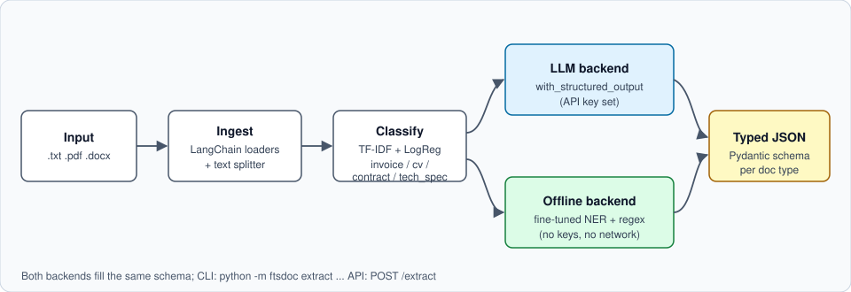

# ftsdoc

**Document intelligence pipeline: classify a document, then extract typed, structured JSON from CVs, invoices, contracts and technical spec sheets.** A fine-tuned transformer NER model and a LangChain pipeline, with an LLM backend when you have an API key and a fully offline backend when you do not.




> **Data note.** All training and evaluation data is **synthetic and fictional** (generated by `scripts/generate_synthetic.py`, seeded Faker names plus invented company names, `example.*` e-mail domains). The reported metrics describe performance on this template-based synthetic set, not on real-world documents. See [Limitations](#limitations).

## Example

Input: `examples/invoice_example.pdf`

```text
INVOICE
Invoice No: INV-2025-73304      (layout abbreviated)
Issue Date: 13.03.2025
Due Date: 4.03.2025
From: Garnet Labs
Bill To: Altavue Systems
Contact: info@example.org
...
Total Due: EUR 81,443.03
```

```bash
python -m ftsdoc extract examples/invoice_example.pdf --json
```

Output (produced by the offline backend, see [`examples/`](examples)):

```json
{
  "source": "invoice_example.pdf",
  "doc_type": "invoice",
  "classifier_confidence": 0.9866653480993801,
  "backend": "offline",
  "data": {
    "invoice_number": "INV-2025-73304",
    "issue_date": "13.03.2025",
    "due_date": "4.03.2025",
    "vendor": "Garnet Labs",
    "customer": "Altavue Systems",
    "contact_email": "info@example.org",
    "total": "EUR 81,443.03"
  }
}
```

Four input/output pairs live in `examples/` (`.txt`, `.pdf`, `.docx`), one per document type. The JSON files are real pipeline output, regenerated with `python scripts/make_examples.py`.

## Results

Held-out test split (10% of 1,000 synthetic documents, split by document, fixed seed). Numbers are copied from `results/*.json`, written by the training scripts.

| Component | Model | Metric | Score |
|---|---|---|---|
| Document type classifier | TF-IDF (1-2 grams) + LogisticRegression | accuracy / macro-F1 (100 docs) | 1.000 / 1.000 |
| Entity extraction (8 types) | `google/bert_uncased_L-4_H-256_A-4`, fine-tuned 12 epochs | seqeval micro P / R / F1 (978 entities) | 1.000 / 1.000 / 1.000 |

Per-entity seqeval scores on the test split (all 1.000): DATE (243), EMAIL (100), INVOICE_NO (25), MONEY (151), ORG (209), PART_NO (26), PERSON (74), SKILL (150). Training took 2.78 minutes on a laptop CPU.

Perfect scores are expected here and should not be read as a general claim: the synthetic documents come from a small set of templates, so the task is easy. They do show that the data generator, BIO labelling, training loop, inference and extraction wiring are consistent end to end. Real-document accuracy is unmeasured.

## Quickstart

```bash
uv venv --python 3.12 .venv && source .venv/bin/activate
uv pip install -r requirements.txt && uv pip install -e .

python scripts/generate_synthetic.py --n-per-type 250 --out data/generated   # 1,000 docs
python -m ftsdoc.classify          # trains classifier, writes models/ + results/classifier_metrics.json
python -m ftsdoc.ner.train         # fine-tunes NER (about 3 min on CPU), writes results/ner_metrics.json

python -m ftsdoc extract examples/contract_example.docx --json
python -m ftsdoc serve             # FastAPI on http://127.0.0.1:8000
curl -F file=@examples/cv_example.txt http://127.0.0.1:8000/extract

pytest                             # 20 tests, no network, no model download
```

Backend selection is automatic: if `ANTHROPIC_API_KEY` (default model `claude-sonnet-5-5`, override with `FTSDOC_LLM_MODEL`) or `OPENAI_API_KEY` (default `gpt-4o-mini`) is set, the LLM backend is used. Otherwise the offline backend runs. Force one with `--backend llm|offline`. The first training run downloads the base model from the Hugging Face Hub.

The LLM backend is covered by a stubbed unit test only; I have not run it against a live API for this repository.

## Project structure

```
src/ftsdoc/
  ingest.py      .txt / .pdf / .docx loaders (LangChain + pypdf + python-docx), text splitter
  classify.py    TF-IDF + LogisticRegression document-type classifier
  ner/           labels, fine-tuning script (train.py), inference (infer.py)
  schemas.py     Pydantic schemas: Invoice, CV, Contract, TechSpec
  extract.py     LangChain pipeline, LLM and offline backends
  offline.py     NER + regex -> schema filling rules
  api.py         FastAPI app (POST /extract, GET /health)
  __main__.py    CLI
scripts/         generate_synthetic.py, make_examples.py
data/sample/     small committed synthetic sample (12 docs + BIO labels)
examples/        sample inputs and the JSON the pipeline produced
results/         metrics written by the training scripts
tests/           pytest suite
assets/          pipeline diagram
```

## How it works

1. **Synthetic data.** `generate_synthetic.py` builds documents from templates, tracking character spans for eight entity types (PERSON, ORG, DATE, MONEY, EMAIL, SKILL, INVOICE_NO, PART_NO). Spans are converted to per-line BIO token labels using the same tokenizer as inference (`tokens.py`), so training and serving see identical tokens. Date and money formats vary.
2. **Ingestion.** LangChain `TextLoader` / `PyPDFLoader` and a small python-docx loader return `Document` objects; `RecursiveCharacterTextSplitter` is available for chunking longer files.
3. **Classification.** A TF-IDF + logistic regression baseline routes each document to a schema.
4. **NER fine-tuning.** `AutoModelForTokenClassification` with first-sub-word labelling, trained with the Hugging Face `Trainer`, evaluated with `seqeval`.
5. **Structured output.** Each document type has a Pydantic schema. The LLM backend uses `prompt | llm.with_structured_output(Schema)`. The offline backend merges NER entities with regex matches (e-mail, invoice number, part number, money, date) and assigns them to fields using line context ("Due Date", "Bill To", "Total").

## Limitations

- Synthetic, template-driven data: metrics are not evidence of real-world performance.
- The offline field assignment relies on line labels such as "Bill To:" and "Total Due:". Free-form layouts need the LLM backend or more training data with varied layouts.
- Documents are processed line by line by the NER model; scanned PDFs need OCR first (not included).
- `langchain-community` is used for the PDF/text loaders and emits a deprecation warning.

## What I'd do next

- Replace the template generator with a mix of real, licensed, anonymised documents plus layout-varied synthetic data, and report entity-level and field-level scores on a truly held-out set.
- Evaluate end-to-end field accuracy (not only token-level F1) and compare the offline and LLM backends side by side.
- Add OCR and layout-aware models (LayoutLM-style) for scanned documents and tables.
- Calibrate classifier confidence and route low-confidence documents to review.
- Containerise the API and add request-size limits and auth.

## License

MIT. See [LICENSE](LICENSE).
